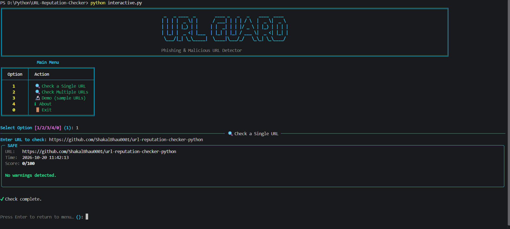
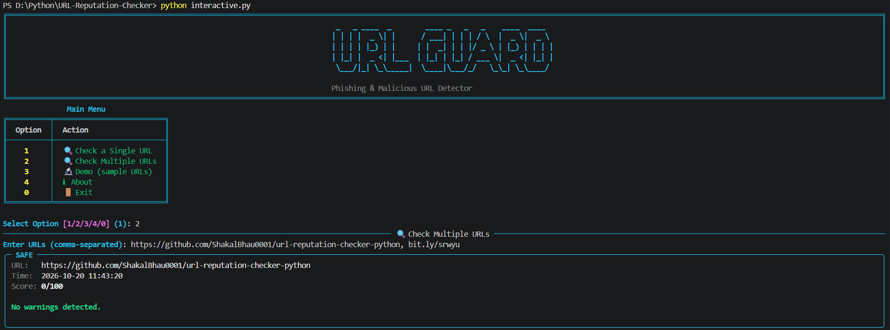
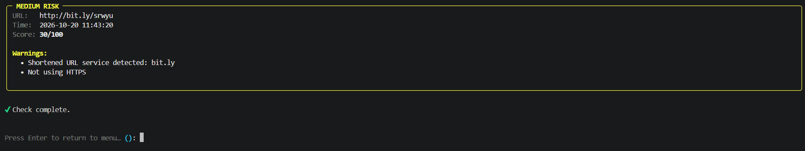
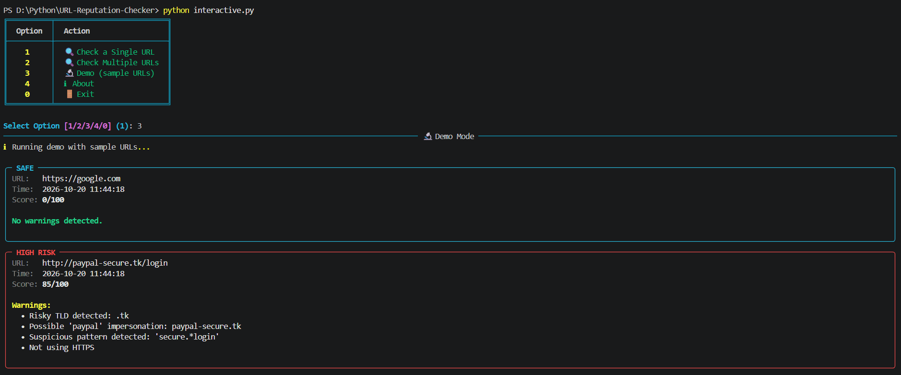
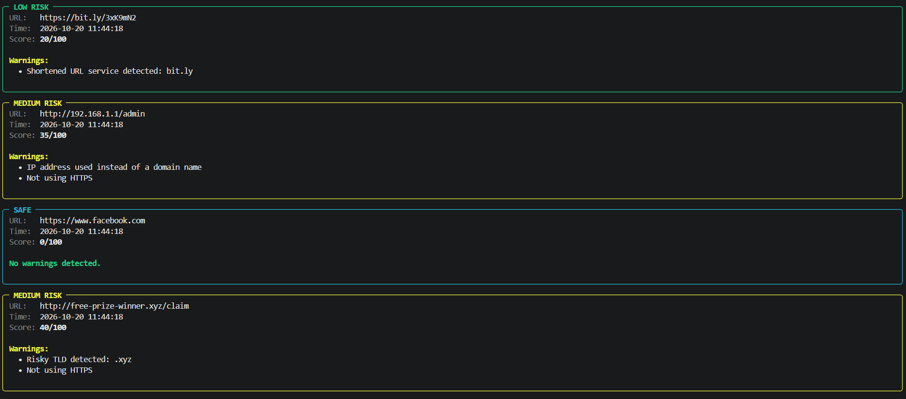
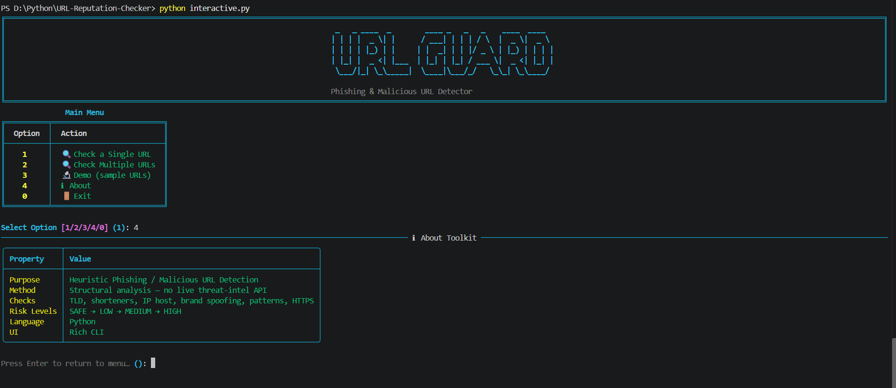
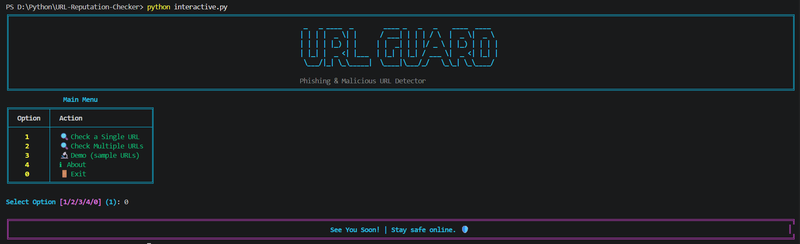

# 🔍 URL-Reputation-Checker 🛡️

A Python-based **URL Reputation Checker** Command Line Tool that scores URLs for **phishing and malicious signs** using **heuristic checks** — risky TLDs, URL shorteners, IP-based hosts, brand impersonation, and suspicious patterns — right from your terminal.

This CLI tool is built for **SOC-style URL triage**, **learning phishing detection basics**, and **CTF/security practice**, combining a **simple no-dependency mode** with a **rich, colorful interactive CLI**.

---

## 🧱 Project Structure

```bash
url-reputation-checker-python/
│
├── assets/              # Screenshots
├── main.py              # Basic CLI application
├── interactive.py       # Rich CLI Version
├── requirements.txt     # Project Dependencies
├── LICENSE              # Project license
└── README.md            # Project documentation
```

---

## ✨ Features

### 🔍 URL Risk Analysis

- Scores every URL from **0 to 100** based on multiple heuristic checks
- Classifies each URL into a clear **risk level**: SAFE, LOW, MEDIUM, or HIGH RISK
- Lists every **warning** that contributed to the score
- Auto-adds `http://` when the scheme is missing (and flags it as not using HTTPS)
- Supports checking a **single URL**, **multiple URLs (comma-separated)**, or a built-in **demo**

### 🧪 Heuristic Checks

- **Risky TLDs** — `.tk`, `.ml`, `.ga`, `.cf`, `.gq`, `.xyz`, `.top`, `.work`, `.date`
- **URL shorteners** — `bit.ly`, `tinyurl.com`, `t.co`, `goo.gl`, `ow.ly`, `is.gd`, `buff.ly`
- **IP address** used instead of a domain name
- **Brand impersonation** — PayPal, Google, Amazon, Facebook, Apple, Microsoft, Netflix, Bank
- **Suspicious patterns** — `secure…login`, `free…gift`, `win…prize`, `verify…account`, `update…payment`, `confirm…identity`, `suspended…account`
- **Excessive subdomains** (more than 4 levels)
- **Suspicious characters** in the domain (`@`, `!`, `~`, `` ` ``, spaces)
- **Unusually long URLs** (over 100 characters)
- **No HTTPS** usage

### 🎨 Rich CLI Interface

- Colored terminal output with a custom **URL GUARD** banner
- Structured **About** table showing tool properties
- Styled result panels — border color changes with the risk level (🔴 red, 🟡 yellow, 🟢 green, 🔵 cyan)
- Handles empty input gracefully

### ⚡ Dual Mode Support

- 🧼 Basic CLI → Lightweight, menu-driven, no dependencies (`main.py`)
- 🎨 Rich CLI → Enhanced UI with colors, panels and menus (`interactive.py`)

---

## 🛠 Technologies Used

| Technology       | Purpose                                               |
| ---------------- | ----------------------------------------------------- |
| **Python 3**     | Core language                                         |
| **urllib.parse** | URL parsing (host, path, netloc)                      |
| **ipaddress**    | Detecting IP-based hosts                              |
| **re**           | Regex-based suspicious pattern matching               |
| **datetime**     | Timestamp for each check                              |
| **Rich**         | Interactive CLI interface                             |
| **pyfiglet**     | ASCII art banner (optional, falls back to plain text) |

---

## ▶️ How to Run

### 1️⃣ Clone the repository

```bash
git clone https://github.com/ShakalBhau0001/url-reputation-checker-python.git
```

### 2️⃣ Enter the project directory

```bash
cd url-reputation-checker-python
```

### 3️⃣ Install Dependencies

```bash
pip install rich pyfiglet
```

**OR**

```bash
pip install -r requirements.txt
```

> ℹ️ The Basic CLI (`main.py`) needs **no external dependencies** — Rich is only required for `interactive.py`, and `pyfiglet` is optional (used only for the banner).

### 4️⃣ Running the Project

#### Basic CLI Version

```bash
python main.py
```

#### Rich Interactive Version

```bash
python interactive.py
```

---

## ▶️ Usage

### Basic CLI (`main.py`)

```bash
============================================================
  🔍 URL REPUTATION CHECKER - SOC Tool
============================================================

Checks URLs for phishing, malware, and suspicious patterns
(Note : Heuristic analysis only — not a live threat-intel lookup)

------------------------------------------------------------
Options:
1. Check a single URL
2. Check multiple URLs (comma-separated)
3. Demo (test with sample URLs)
0. Exit

Choice (0-3): 1
Enter URL: http://paypal-secure.tk/login

==================================================
  🔴 HIGH RISK
==================================================
  URL: http://paypal-secure.tk/login
  Time: 2026-10-20 11:42:13
  Risk Score: 85/100

  Warnings:
    ⚠️ Risky TLD detected: .tk
    ⚠️  Possible 'paypal' impersonation: paypal-secure.tk
    ⚠️  Suspicious pattern detected: 'secure.*login'
    ⚠️  Not using HTTPS
==================================================
```

```bash
Choice (0-3): 2
Enter URLs (comma-separated): https://github.com, bit.ly/srwyu
```

### Rich Interactive CLI (`interactive.py`)

```bash
[1] 🔍 Check a Single URL
[2] 🔍 Check Multiple URLs
[3] 🔬 Demo (sample URLs)
[4] ℹ About
[0] 🚪 Exit

Select Option: 1
Enter URL to check: https://github.com

╭─ SAFE ─────────────────────────╮
│ URL:   https://github.com      │
│ Time:  2026-10-20 11:42:13     │
│ Score: 0/100                   │
│                                │
│ No warnings detected.          │
╰────────────────────────────────╯

✔ Check complete.
```

---

## 📁 Supported Input

- **Single URL:** With or without scheme (`example.com` → `http://example.com`)
- **Multiple URLs:** Comma-separated list in one line
- **Demo Mode:** 8 built-in sample URLs (safe, shortened, IP-based, impersonation, risky TLD)
- **Output:** Risk score, risk level, timestamp, and a list of warnings

> ⚠️ This tool performs **heuristic (structural) analysis only** — it does **not** query any live threat-intelligence service.

---

## ⚙️ How It Works

**1️⃣ Normalization**

- Trims the input and adds `http://` if no scheme is provided
- Parses the URL into host, path, and authority using `urlparse`

**2️⃣ Heuristic Scoring**

Each check adds points to the risk score (capped at **100**):

| Check                              | Score |
| ---------------------------------- | ----- |
| Risky TLD                          | +30   |
| Brand impersonation                | +30   |
| IP address instead of domain       | +25   |
| Suspicious characters in authority | +25   |
| URL shortener                      | +20   |
| Suspicious pattern (each match)    | +15   |
| Excessive subdomains (> 4 levels)  | +15   |
| Unusually long URL (> 100 chars)   | +10   |
| Not using HTTPS                    | +10   |

**3️⃣ Risk Classification**

| Score    | Risk Level     |
| -------- | -------------- |
| 0 – 9    | ✅ SAFE        |
| 10 – 29  | 🟢 LOW RISK    |
| 30 – 59  | 🟡 MEDIUM RISK |
| 60 – 100 | 🔴 HIGH RISK   |

---

## ⚠️ Common Errors

- **Empty URL input** → Rejected with an error message (Rich CLI) or silently skipped (Basic CLI)
- **Malformed URL** → Reported as `UNKNOWN` risk level with the parsing error
- **`ModuleNotFoundError: rich`** → Install dependencies using `pip install -r requirements.txt` (only needed for `interactive.py`)
- **Plain-text banner instead of ASCII art** → `pyfiglet` is not installed (optional dependency)

---

## 🌟 Future Enhancements

- Integration with live threat-intel APIs (VirusTotal, Google Safe Browsing)
- Argument-based CLI mode (`parser.py`) for scripting and automation
- Read URLs from a file and export results to JSON/CSV
- WHOIS / domain-age based checks
- Punycode / homograph (lookalike character) detection

---

## 📦 Related Projects

This repository focuses on a **specific heuristic detection technique** implemented as a **command-line (CLI) learning project**.

The goal of this project is to:

- Understand how phishing URLs can be spotted from their structure alone
- Practice rule-based risk scoring in Python
- Learn how simple CLI-based security tools are structured

For more advanced, security-focused CLI tools, check out:

> 🔗 **[CLI Projects](https://github.com/stars/ShakalBhau0001/lists/cli-projects)**

---

## ⚠️ Disclaimer

> This project is intended for **educational and learning purposes only**.

> _Results are based on simple heuristics and may produce false positives or false negatives. A "SAFE" result does not guarantee that a URL is trustworthy — always verify suspicious links using trusted threat-intelligence services._

---

## 📸 Preview

### 1. **Check Single URL**



### 2. **Check Multiple URLs**




### 3. **Demo Mode**




### 4. **About**



### 5. **Exit**



---

## 🪪 Author

> **Creator: Shakal Bhau**

> **GitHub: [ShakalBhau0001](https://github.com/ShakalBhau0001)**

---

## ⭐ Support

If you like this project, consider giving it a ⭐ on GitHub!

---
